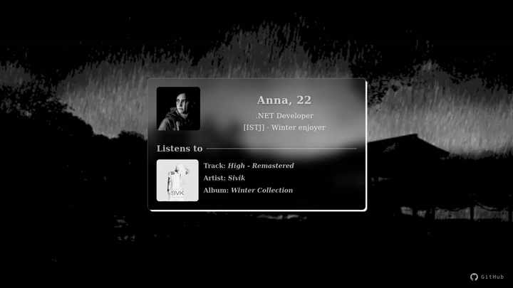

# SpotiListener

A personal listening status page that displays information about me and
the music currently playing in Spotify.

## Preview


## Features

-  Current track, artist and album information.
- Album artwork retrieval via MPRIS.
- Automatic status updates.
- Responsive Blazor UI.

## Architecture

The application is divided into independent .NET projects:

-   **SpotiListener.Core** - shared models and interfaces.
-   **SpotiListener.Mpris** - retrieves playback information through
    D-Bus and MPRIS.
-   **SpotiListener.Agent** - exposes the current track through a
    local HTTP API.
-   **SpotiListener.Web** - Blazor Web App that displays the listening
    status.

## Technologies

-   C#
-   .NET 8
-   ASP.NET Core
-   Blazor
-   D-Bus / MPRIS
-   HTML, CSS

## Requirements

-   Linux with a running Spotify desktop client.
-   .NET 8 SDK.
-   A session D-Bus environment.

## Running

Start the Agent:

``` bash
dotnet run --project src/SpotiListener.Agent
```

Start the Web application in another terminal:

``` bash
dotnet run --project src/SpotiListener.Web
```

Make sure the Agent URL in the Web application's configuration matches
the address and port on which the Agent is listening.

## Docker (Containerized Setup)
### 1. Run the Agent (Host Machine)

The Agent must run natively on your Linux host to access the active session's D-Bus socket for Spotify:

```bash
dotnet run --project src/SpotiListener.Agent
```
The Agent will start listening on http://0.0.0.0:5055.

### 2. Run the Web Application (Docker)
Launch the Blazor Web interface using Docker Compose:

```bash
docker compose up --build -d
```

The Web UI will be available at http://localhost:8080.

**Note**: The Web container uses host.docker.internal to communicate with the Agent running on port 5055 of your host OS.

## Environment Variables

| Variable | Description | Default |
| :--- | :---: | ---: |
| ASPNETCORE_HTTP_PORTS | HTTP port exposed inside the Docker container | 8080 |
| Agent__BaseUrl | URL used by the Web UI to contact the Agent | http://host.docker.internal:5055 |

------------------------------------------------------------------------
